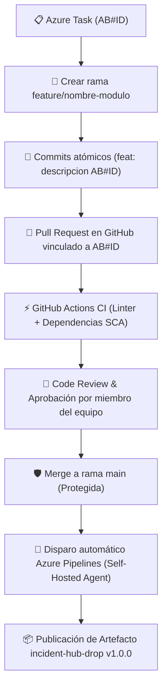

# 🌿 Estrategia de Ramificación (Branching Strategy)

El proyecto implementa una variante optimizada de **GitHub Flow** con políticas estrictas de protección:

## 1. Convención de Ramas
* **`main`:** Rama productiva y estable. Se encuentra protegida contra pushes directos. Solo recibe cambios a través de Pull Requests aprobados que hayan superado las pruebas de CI.
* **`feature/*`:** Desarrollo de nuevas capacidades (ej. `feature/api-incidents`, `feature/ui-dashboard`).
* **`fix/*`:** Corrección de defectos o fallos en pipelines (ej. `fix/pipeline-error`).
* **`refactor/*`:** Modificaciones estructurales o resolución de deuda técnica (ej. `refactor/tech-debt`).

## 2. Flujo Obligatorio de Trazabilidad



```text
[Azure Work Item (AB#ID)]
         │
         ▼
[Crear rama: feature/nombre-modulo]
         │
         ▼
[Commits atómicos con mensaje: "feat(modulo): descripcion AB#ID"]
         │
         ▼
[Pull Request en GitHub vinculado al AB#ID]
         │
         ▼
[GitHub Actions CI: Linter + Dependencias aprobadas]
         │
         ▼
[Code Review & Aprobación por miembro del equipo]
         │
         ▼
[Merge a rama main]
         │
         ▼
[Disparo automático de Azure Pipelines (Self-Hosted Agent)]
```
