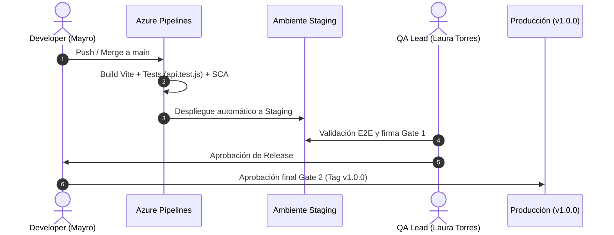

# 🚀 Estrategia de Release, Ambientes y Versionamiento Semántico (CD)

> **Proyecto:** IT Incident Hub  
> **Líder de DevOps & Release Manager:** Mayro Geovanni Barrios Gameros (`@MayroGamerosXZ`)  
> **Trazabilidad Azure Boards:** `AB#28`, `AB#29`, `AB#30`, `AB#31`  

---

## 1. Arquitectura de Despliegue Progresivo y Ambientes

El ciclo de Entrega Continua (CD) implementa una progresión controlada a través de tres ambientes con compuertas de aprobación (*Approval Gates*) obligatorias:

```text
       [ Pipeline CI: Build & Test (Build #12) ]
                          │
                          ▼
             [ Artefacto: incident-hub-drop ]
                          │
                          ▼
            ┌───────────────────────────┐
            │   Ambiente DEVELOPMENT    │  -> Despliegue automático tras pasar CI en main.
            └─────────────┬─────────────┘
                          │
                          ▼  [Gate 1: Pruebas de Regresión y Aprobación QA - Laura Torres]
            ┌───────────────────────────┐
            │    Ambiente STAGING       │  -> Pruebas de integración, rendimiento y seguridad.
            └─────────────┬─────────────┘
                          │
                          ▼  [Gate 2: Aprobación Final Obligatoria - Mayro Gameros (DevOps Lead)]
            ┌───────────────────────────┐
            │   Ambiente PRODUCCIÓN     │  -> Versión final productiva etiquetada con SemVer v1.0.0.
            └───────────────────────────┘
```



### Especificación de Ambientes

| Ambiente | Propósito | Trigger de Despliegue | Responsable de Aprobación |
|---|---|---|---|
| **Development** (Dev) | Integración continua y pruebas preliminares de desarrolladores. | Automático (Push a `main` / PR merge). | Pipeline automatizado |
| **Staging** (Pre-Prod) | Homologación idéntica a producción para pruebas end-to-end y auditorías de seguridad. | Automático al aprobar Gate 1. | **Laura Torres** (QA & Test Specialist) |
| **Production** (Prod) | Servicio oficial para usuarios finales de la organización. | Manual con firma digital (Gate 2). | **Mayro Geovanni Barrios Gameros** (DevOps & Cloud Lead) |

---

## 2. Compuertas de Aprobación y Gobernanza (Approval Gates)

Para autorizar la promoción del artefacto `incident-hub-drop` entre ambientes se exigen los siguientes criterios de calidad:

1. **Gate 1 (Promoción a Staging):**
   * Cobertura de pruebas unitarias al 100% (7/7 pruebas pasando en `tests/api.test.js`).
   * Escaneo de dependencias sin vulnerabilidades críticas o altas (`npm audit --audit-level=high`).
   * Verificación de empaquetado del frontend y backend en el directorio de artefactos.
   * Aprobación firmada en Azure DevOps por el rol de QA.

2. **Gate 2 (Promoción a Producción):**
   * Validación del informe de fallo controlado resuelto (`docs/fallo_controlado.md`).
   * Verificación de la política de cero secretos en código (variables inyectadas desde `incident-hub-secrets`).
   * Creación del Git Tag correspondiente bajo estándar SemVer 2.0.0.
   * **Aprobación manual obligatoria del DevOps Lead (Mayro Gameros).**

---

## 3. Estrategia de Semantic Versioning (SemVer 2.0.0 - AB#31)

La evolución del sistema a lo largo del proyecto integrador se estructura en tres hitos de versionado formally etiquetados en Git:

| Tag SemVer | Hito Asociado | Características y Cambios Incluidos | Estado |
|---|---|---|---|
| **`v0.1.0`** | **Semana 1** | Arquitectura base modular, esquema DDL relacional en PostgreSQL, CRUD REST de incidentes, filtros dinámicos y primeros 7 PRs fusionados. | 🟢 Completado |
| **`v0.2.0`** | **Semana 2** | Integración Continua dual (GitHub Actions + Azure Pipelines), ejecución en Self-Hosted Agent local, resolución de deudas técnicas DT-1 y DT-2, grupo de secretos protegidos y evidencia de fallo controlado. | 🟢 Completado |
| **`v1.0.0`** | **Semana 3** | **Release de Producción Oficial:** Estabilización integral, suite de pruebas automatizadas en verde, documentación técnica sellada, empaquetado del artefacto `incident-hub-drop` y cierre total de Epics en Azure Boards. | 🟢 Completado |

---

## 4. Política de Rollback y Contingencia

En caso de detectarse una anomalía en el ambiente productivo:
1. **Rollback de Artefacto Inmediato:** Azure Pipelines permite redeployar el último artefacto estable previo con un solo clic desde la biblioteca de releases históricas.
2. **Reversión en Git:** Se ejecuta `git revert -m 1 <commit-hash>` generando un nuevo PR de emergencia (`hotfix/*`) con trazabilidad en Azure Boards.
3. **Restauración de Base de Datos:** Se cuenta con los scripts de respaldo DDL y seed de datos en `database/schema.sql` y `database/seed.sql` para restauración consistente.
